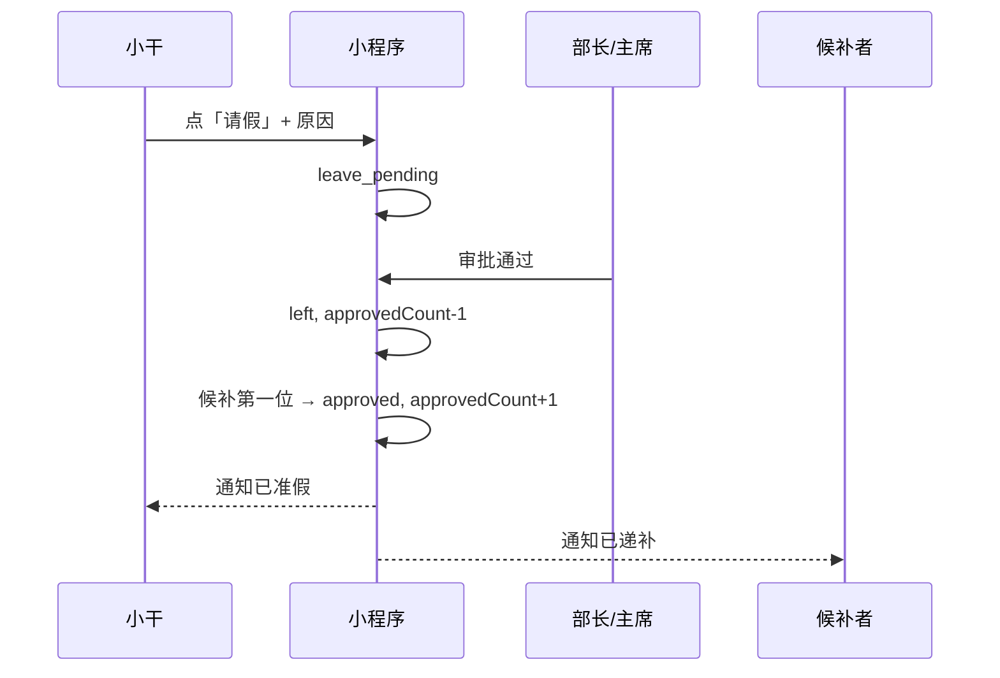
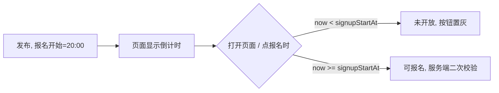
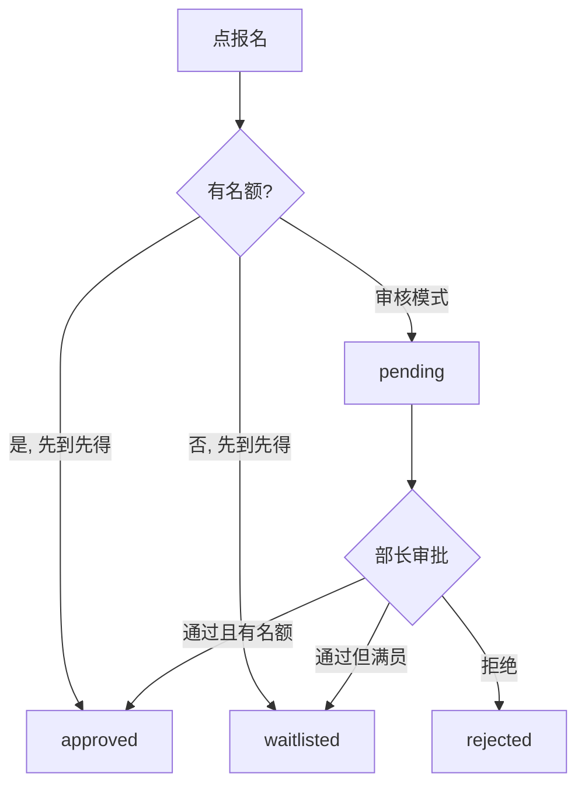
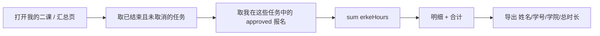

# 卡小西 · 广工影协指南 — 需求与设计

| 项目 | 内容 |
|---|---|
| 文档版本 | **v0.7** |
| 更新日期 | 2026-11-16 |
| 工程名 | **卡小西**（小程序名称待定，代码库先用此名） |
| 使用范围 | **仅影协内部**，不对外开放、不做游客浏览 |
| 技术前提 | 个人主体小程序 + 微信云开发，不涉及任何资金 |
| 配套文档 | [02-技术方案.md](./02-技术方案.md) |

> 【已定】= 影协已拍板；【待定】= 尚未确定但不阻塞开发；【不做】= 明确排除。

---

## 1. 背景与定位

### 1.1 一句话

**影协内部的任务与协作工具**：部长发活、小干报名、系统提醒、年历留痕、二课可查。

### 1.2 解决的问题【已定】

| 痛点 | 卡小西怎么做 |
|---|---|
| 派活靠群刷屏 | 任务列表 + 定时开放报名 |
| 报名靠接龙，漏人重复 | 在线报名 + 名额校验 + 候补队列 |
| 临时有事没人顶 | 请假审批 → 候补自动递补 |
| 提醒靠自觉 | 活动开始前 2 小时订阅消息 |
| 二课统计靠翻记录 | 按名单实时统计，年度汇总一键导出 |
| 年历散落各处 | 统一年历 |
| 待办只在前任脑子里 | 个人/部门待办 + 任务自动生成 |

### 1.3 成功指标

| 指标 | 目标 |
|---|---|
| 成员激活率 | ≥ 80%（约 70 人/学年） |
| 任务线上报名率 | ≥ 90% |
| 提醒开启率 | ≥ 60%（一次性订阅有上限） |
| 二课汇总人工工时 | 从 2 天降到 1 小时 |

---

## 2. 组织、角色与权限

### 2.1 组织结构【已定】

```
影协
├── 主席（1 人）
├── 摄影师队  部长 + 小干
├── 宣传部    部长 + 小干
└── 运营部    部长 + 小干
```

- 角色：**主席 chairman / 部长 minister / 小干 member**；
- 部门：**摄影师队 photo / 宣传部 pr / 运营部 ops**；
- 小干必须归属一个部门；
- 任务可面向**全体**或**指定部门**；
- 另有**访客 guest**：只存在于本机，不注册、不调用云函数、不接触协会数据。

### 2.1.1 访客模式

- 入口：信息注册页「访客登录」；
- 可见：首页（本地空数据）、我的（访客资料）、关于；
- 可改：本机昵称、学院，保存在 `guest.session.v1`，退出即清除；
- 不可用：任务、年历、待办、报名、请假、消息、二课、成员管理、设置、发布、上传头像；
- 隔离：`services/api.js` 对所有云函数调用直接拒绝（code 40301），保证访客读不到、也写不进云端；
- 安全：不收集学号/手机号/宿舍，不写入 `members`，不产生 openid 绑定。

### 2.2 权限矩阵【已定】

| 功能 | 小干 | 部长 | 主席 |
|---|:--:|:--:|:--:|
| 查看全体任务 | ✅ | ✅ | ✅ |
| 查看本部门专属任务 | ✅ | ✅ | ✅ |
| 报名 / 取消报名 / 请假 | ✅ | ✅ | ✅ |
| 发布搬砖（拍摄任务） | ❌ | ✅ | ✅ |
| 审核报名、审批请假、移除名单 | ❌ | ✅ 本部门发布的 | ✅ 全部 |
| 查看年历（公开日程） | ✅ | ✅ | ✅ |
| 查看年历（内部日程） | ❌ | ✅ | ✅ |
| 建 / 改 / 删年历事件 | ❌ | ✅ | ✅ |
| 年历列表视图 | ❌ | ✅ | ✅ |
| 个人待办 | ✅ | ✅ | ✅ |
| 部门 / 全体待办 | 看本部门 | ✅ 建本部门 | ✅ 建任意部门 |
| 内部待办（`staff`） | ❌ | ✅ | ✅ |
| 加入 / 退出待办协作 | ✅ | ✅ | ✅ |
| 完成待办 | 主责人 / 参与人 | 同左 + 本部门 | 全部 |
| 删除待办 | 仅自己建的 | 本部门 | 全部 |
| 查看成员学号/电话/宿舍 | ❌ | ✅ 本部门发布任务的报名者 | ✅ 全部 |
| 查看同活动成员姓名+电话 | ✅ | ✅ | ✅ |
| 二课汇总 | 仅自己 | 本部门发布的任务 | 全部 |
| 成员审核 / 改角色 | ❌ | ❌ | ✅ |
| 学年归档 / 系统设置 | ❌ | ❌ | ✅ |

> **部长的边界**：管本部门的人、本部门的待办、自己部门发布的任务；**审核权跟着任务走**——谁发布的任务谁审，主席兜底。

---

## 3. 核心场景

1. **发活**：部长发「周六、周日两场，每天 9:00–12:00，中心湖外拍，招 6 人，报名周五 20:00 截止，二课 4 学时，收图方式：群相册」，可设为「立即报名」或「定时开抢」。
2. **报名**：先到先得直接成功；审核模式等部长审；满员进候补。
3. **请假**：已报名的人点「请假」并填原因 → **立即生效**，名额自动顺延给候补第一位。
4. **二课**：活动时间一到自动变「已结束」，学时**实时统计**；部长只需在必要时删掉没来的人，数字自动变。
5. **待办**：部门待办分高/中/低；任务发布、活动当天、活动结束自动生成待办。
6. **年历**：招新、例会、外拍、比赛、展览统一维护，任务自动落事件。

---

## 4. 功能范围

| 模块 | 功能 | 优先级 | 版本 |
|---|---|:--:|:--:|
| 账号 | 微信登录 + 注册（姓名/学号/学院/电话/宿舍/部门） | P0 | MVP |
| 账号 | 主席审核入会、改角色/部门、毕业归档 | P0 | MVP |
| 账号 | 学年手动切换与归档 | P0 | MVP |
| 发布 | **统一发布入口**：搬砖（任务）/ 部门待办 / 年历日程 | P0 | MVP |
| 任务 | 发布：名称、**多天多时段**、详情+附件（图片/PDF）、地点、人数、**报名开始**、**报名截止**、二课学时（整数）、收图方式、可见范围 | P0 | MVP |
| 任务 | 两种报名模式：先到先得 / 报名审核 | P0 | MVP |
| 任务 | 定时开放报名 | P0 | MVP |
| 任务 | 报名 / 取消 / 候补 | P0 | MVP |
| 任务 | 请假申请 + 部长/主席审批 + 自动递补 | P0 | MVP |
| 任务 | 报名管理：通过/拒绝/移除名单 | P0 | MVP |
| 任务 | 我的报名 | P0 | MVP |
| 二课 | 实时统计、年度汇总、导出 CSV（姓名/学号/学院/总时长） | P0 | MVP |
| 提醒 | 首场开始前 2 小时订阅消息（已实现，待配活动模板 ID） | P0 | MVP |
| 提醒 | 待办截止当天 9:00 订阅消息 | P1 | MVP |
| 提醒 | 每次提醒都写站内信兜底 | P0 | MVP |
| 提醒 | 提醒设置页（授权状态与发送统计） | P1 | MVP |
| 提醒 | 报名结果/候补转正/请假结果 站内通知 | P0 | MVP |
| 年历 | 月视图 + 列表视图、事件详情 | P0 | MVP |
| 年历 | 公开 / 内部两档可见范围 | P0 | MVP |
| 年历 | 主 / 副负责人、6 种状态、提醒日字段 | P0 | MVP |
| 年历 | 任务自动落事件 | P0 | MVP |
| 待办 | 四档可见范围（仅自己 / 本部门 / 全体 / 内部） | P0 | MVP |
| 待办 | 加入 / 退出协作（无需审批） | P0 | MVP |
| 待办 | 重要性三级、截止日期 | P0 | MVP |
| 待办 | 任务自动生成待办 | P0 | MVP |
| 其他 | 卡小西形象、空状态 | P0 | MVP |
| 交付 | 小程序内交片 | — | **不做** |
| 图片 | 除任务封面/附件外的上传 | — | **不做** |
| 到场 | 签到/到场登记 | — | **不做** |
| 重复 | 年历重复事件（每周例会等） | — | **不做** |
| 对外 | 游客浏览、公开主页 | — | **不做** |
| 支付 | 在线支付 | — | **不做** |
| 后台 | 网页管理端 | — | **不做** |

**MVP**：部长能发活（定时、二课、收图），小干能报名/候补/请假，系统能提醒，主席能管人、看二课汇总。

---

## 5. 关键业务规则

### 5.1 为什么只有一张 `tasks` 表【已定】

所有活动——正式拍摄、临时帮拍——结构完全一样，**统一为「搬砖（任务）」**，数据上只有 `tasks` 一张表。区别只体现在字段和报名模式上：

| 字段 | 取值 | 含义 |
|---|---|---|
| `signupMode` | `first_come` / `review` | 先到先得 / 报名审核 |
| `audience` | `all` / `depts` | 面向全体 / 指定部门 |

> 「搬砖」就是拍摄任务的口语叫法，不是第二种业务：只有一张 `tasks` 表，一个发布入口，靠 `signupMode` 和 `audience` 组合出不同形态。

### 5.2 两个状态维度（都按时间自动推导，不手工流转）

**活动状态**只有三态，到点自动变，没有任何「结束/结算」按钮：

| 活动状态 | 判定 |
|---|---|
| 未开始 | `now < startAt` |
| 进行中 | `startAt ≤ now < endAt` |
| 已结束 | `now ≥ endAt` |

> 一个活动可以有**多天多时段**（`sessions`），`startAt` 取首场开始、`endAt` 取末场结束。两场之间的空档仍显示「进行中」，详情页用「今日有场 / 下一场 11-22 09:00」提示。

**报名状态**独立，也按时间自动推导：

| 报名状态 | 判定 |
|---|---|
| 未开放 | `now < signupStartAt` |
| 报名中 | `signupStartAt ≤ now < signupDeadline` |
| 已截止 | `now ≥ signupDeadline` |

两个维度互不影响：活动可能「未开始但报名已截止」，也可能「进行中但报名还在开放」（现场补人）。

**只要两个例外字段**：

| 字段 | 作用 |
|---|---|
| `published` | false = 草稿，仅发布人可见 |
| `cancelledAt` | 非空 = 已取消，不再显示、不计入统计 |

> 因为没有手工流转，所以**不需要定时任务去改状态**——页面打开时按服务器时间算即可，永远不会出现「到点了但状态没变」。

### 5.3 报名规则【已定】

| 规则 | 先到先得 | 报名审核 |
|---|---|---|
| 提交后 | 有名额 → `approved`；满 → `waitlisted` | 先 `pending` |
| 部长/主席操作 | 无需审核 | 通过 → 有名额则 `approved`，满则 `waitlisted`；拒绝 → `rejected` |
| 名额计算 | 只算 `approved` | 同左 |
| 候补顺序 | 按报名时间 | 同左 |
| **报名截止** | **独立字段，必须单独设置**（须早于**首场**开始，默认等于首场开始），到点后不能再报名 | 同左 |
| 取消报名 | **不提供**；已报名后只能按流程请假（请假即释放名额并自动递补） | 同左 |
| 重复报名 | 禁止（唯一索引） | 同左 |
| 报名数量上限 | 不限制 | 同左 |

**状态**：`pending` 待审 / `approved` 已通过 / `waitlisted` 候补 / `rejected` 已拒 / `withdrawn` 已取消 / `leave_pending` 请假待审 / `left` 已请假。

### 5.4 请假与自动递补【已定】

1. 只有 `approved` 的人可以请假；报名后**不能取消报名**，只能走请假；
2. **不设请假截止**，任何时间都可提交，**提交即生效，无需审批**；
3. 请假 → 该成员置 `left`，**立即**把候补第一位转 `approved`；
4. 活动已开始时不能请假（`startAt <= now` 直接拒绝）；
5. 请假原因必填，≤200 字；
6. 请假生效后给本人和发布人各发一条站内消息。



### 5.5 二课时长【已定：实时统计，不落流水】

- 发布任务时**只填本次活动的学时数**（**整数**，常用 2 / 4 / 8，填 0 表示不计二课），不做必修/选修、不设上限、不区分类型；
- **不做签到/到场登记**，**没有「结算」，也没有「入账」**——不生成任何二课流水记录；
- 二课数字 = 该成员在**所有「已结束、未取消、学时 > 0」的任务**里状态为 `approved` 的学时之和，页面打开时实时算；
- 部长在名单里**移除**某人（确认没来），这个人立刻从统计里消失，不需要任何"冲销"操作；
- 年度汇总：按**学年**归集，实时求和。学年以 **8 月 1 日**为界：8 月 1 日及以后算新学年，7 月 31 日及以前算旧学年（如 2026-08-01 → `2026-2027`，2026-07-31 → `2025-2026`）；归属看**活动开始时间**，不看发布时间；
- 导出 CSV **只有四列**：`姓名`、`学号`、`学院`、`总时长`。

**为什么不落流水账**：账本的作用是「冻结历史 + 加快查询」。你们一年 70 人、约 1000 条报名，实时聚合一次只要几十毫秒；而导出 CSV 本身就是一份不可变的历史快照。多一张流水表，就多一套生成、回滚、对账的逻辑，收益为负。

> 一句话：**名单即到场，实时算，删人即少。**

### 5.6 待办规则【已定】

| 类型 | 归属 | 谁能建 | 谁能看 |
|---|---|---|---|
| 个人待办 | 自己 | 自己 | 自己 |
| 部门待办 | 部门 | 本部门部长、**主席** | 本部门 + 主席 |

- 重要性：**高 / 中 / 低**（3/2/1），排序：未完成 → 重要性 → 截止时间；
- **任务自动生成待办**（先按此实现，后续可调）：

| 触发 | 生成给 | 内容 | 截止 |
|---|---|---|---|
| 任务发布 | 发布人 | 确认报名名单 | 报名截止前 1 天 |
| 活动当天 08:00 | 发布人 | 现场组织 | 活动结束 |
| 活动结束 | 发布人 | 核对名单 + 收图 | 结束后 2 天 |

- 自动待办带 `source=task`，任务取消时自动作废；发布人可手动删除。

### 5.7 年历规则

- 类型：招新 / 例会 / 外拍 / 比赛 / 展览 / 截止 / 其他；
- 全部仅会员可见；
- **不做重复事件**（每周例会请每周建一条，或直接发部门待办）；
- 事件可以跨天（`allDay` + 起止）；
- 任务发布后自动生成事件（V1.1），改期同步；
- 月视图 + 列表，按类型筛选。

### 5.8 统一发布入口

首页和任务页的「+」是一个**入口**，点开选三类之一，各自复用现有表单：

| 类型 | 谁能发 | 落到哪个集合 |
|---|---|---|
| 搬砖（拍摄任务） | 部长/主席 | `tasks` |
| 部门待办 | 本部门部长 / 主席 | `todos`（scope=dept） |
| 年历日程 | 部长/主席 | `calendar_events` |

> 「搬砖」就是拍摄任务的口语叫法，数据上统一叫 `tasks`，不再分「任务 / 搬砖」两个概念。

### 5.9 成员资料与可见性【已定】

注册时一次性填写（生日选填）：

| 字段 | 必填 | 主席 | 部长 | 同活动成员 |
|---|:--:|:--:|:--:|:--:|
| 姓名 | ✅ | ✅ | ✅* | ✅ |
| 学号 | ✅ | ✅ | ✅* | ❌ |
| 学院 | ✅ | ✅ | ✅* | ❌ |
| 电话 | ✅ | ✅ | ✅* | ✅ |
| 宿舍号 | ✅ | ✅ | ✅* | ❌ |
| 部门 | ✅ | ✅ | ✅ | ✅ |
| 角色 | 系统 | ✅ | ✅ | ✅ |

\* **部长的可见范围 = 本部门发布的任务的报名者**；不是本部门发布的任务，只能看到姓名和部门。

- 同活动成员 = 同一任务下 `approved` / `leave_pending` / `left` 的人，互相可见**姓名 + 电话**；
- 头像不上传，用姓名首字 + 配色生成；
- 本人可改电话、宿舍；姓名/学号找主席改。

---

## 6. 信息架构

```
卡小西（仅登录后可见）
├── 首页
│   ├── 近期任务（报名中 / 即将开始）
│   ├── 我的待办
│   ├── 本周年历
│   └── 快捷入口：发布（搬砖 / 部门待办 / 年历日程）
├── 任务
│   ├── 任务列表（全部 | 本部门 | 我参与的）
│   ├── 任务详情（报名 / 候补 / 请假 / 名单）
│   ├── 发布搬砖
│   └── 报名管理（通过/拒绝/移除/请假审批）
├── 年历
│   ├── 月视图 / 列表
│   ├── 事件详情
│   └── 新建事件（部长+）
└── 我的
    ├── 资料
    ├── 我的报名
    ├── 我的二课
    ├── 消息
    ├── 成员管理（主席）
    ├── 二课汇总（部长/主席）
    └── 设置（主席）
```

**TabBar**：首页 / 任务 / 年历 / 我的。

---

## 7. 页面清单

| # | 页面 | 路由 | 角色 | 核心内容 |
|---|---|---|---|---|
| 1 | 启动登录 | `pages/launch/index` | 全部 | 静默登录、状态分流 |
| 2 | 注册 | `pages/join/index` | 未注册 | 6 项必填 |
| 3 | 待审核 | `pages/join/pending` | 未审核 | 状态、联系主席 |
| 4 | 首页 | `pages/home/index` | 会员 | 任务、待办、年历、快捷入口 |
| 5 | 任务列表 | `pages/task/list` | 会员 | 三个 tab、状态筛选 |
| 6 | 任务详情 | `pages/task/detail` | 会员 | 信息、倒计时、名单、报名/候补/请假 |
| 7 | 发布 | `pages/publish/index` → `pages/task/edit` / `pages/todo/edit` / `pages/calendar/edit` | 部长+ | 先选类型：搬砖 / 部门待办 / 年历日程 |
| 8 | 报名管理 | `pages/task/manage` | 发布人/主席 | 待审、通过、候补、请假审批、移除名单 |
| 9 | 我的报名 | `pages/task/mine` | 会员 | 进行中/已结束/已取消 |
| 10 | 年历月视图 | `pages/calendar/month` | 会员 | 月网格 |
| 11 | 年历列表 | `pages/calendar/list` | 会员 | 类型筛选 |
| 12 | 事件详情 | `pages/calendar/detail` | 会员 | 详情、关联任务 |
| 13 | 新建事件 | `pages/calendar/edit` | 部长+ | 表单 |
| 14 | 待办列表 | `pages/todo/list` | 会员 | 个人/部门、按重要性 |
| 15 | 待办编辑 | `pages/todo/edit` | 会员 | 标题、截止、重要性、部门 |
| 16 | 消息中心 | `pages/message/list` | 会员 | 分类、已读 |
| 17 | 我的资料 | `pages/mine/profile` | 会员 | 查看/改电话宿舍 |
| 18 | 我的二课 | `pages/mine/erke` | 会员 | 明细 + 年度合计 |
| 19 | 成员管理 | `pages/admin/members` | 主席 | 审核、改角色部门 |
| 20 | 二课汇总 | `pages/admin/erke` | 部长/主席 | 按人汇总、导出四列 CSV |
| 21 | 设置 | `pages/admin/settings` | 主席 | 学年切换、任命主席/部长 |

---

## 8. 核心流程

### 8.1 定时开抢



### 8.2 报名



### 8.3 二课统计



---

## 9. 设计规范

### 9.1 卡小西形象【已定】

**蓝色相机精灵**：机身圆角蓝色，正面一张粉色圆脸（两只眼睛、腮红、小嘴），头顶蓝色取景窗，镜头环内圈刻中英文「广工影协 / GUANGDONG UNIVERSITY OF TECHNOLOGY PHOTOGRAPHY ASSOCIATION」，机身右上角写「广工影协」，左上两颗黄色星芒，短手短脚。

**风格**：粗黑描边（约 8–10px @1000px）、手绘抖动感、纯色平涂、无渐变、圆润。

**色板（取色自设计稿）**

| 名称 | 色值 | 用途 |
|---|---|---|
| 相机蓝 | `#83A7BD` | 主色、主按钮、选中态 |
| 取景窗蓝 | `#60B7D2` | 强调、标签 |
| 深蓝灰 | `#375668` | 镜头环、次级文字 |
| 面颊粉 | `#FFE1E3` | 背景块、卡片底纹 |
| 星光黄 | `#FEE775` | 提醒、角标、高亮 |
| 描边黑 | `#111111` | 文字、描边 |

**使用规则**

- 主形象用于启动页、空状态、关于页；
- 头像用 512×512 方图，小尺寸（≤120px）用简化版（去掉镜头环文字，否则糊成一团）；
- 现有素材只有 1 个姿态，建议补 3 个表情：**开心 / 提醒 / 抱歉**，用于报名成功、提醒、名额已满；
- 禁忌：不拉伸变形、不改主色、不加投影和渐变。

### 9.2 界面基调

| 项 | 方案 |
|---|---|
| 主色 | 相机蓝 `#83A7BD`（跟随 IP，替换 v0.2 的橙色） |
| 辅色 | 深蓝灰 `#375668`、星光黄 `#FEE775` |
| 背景 | 暖白 `#FAF7F2`，卡片纯白 |
| 语义色 | 成功 `#3E9B6B`、警告 `#D9A441`、错误 `#C94F4F` |
| 圆角 / 间距 | 卡片 16px / 8pt 栅格 |
| 字体 | 系统字体 |

### 9.3 状态

| 状态 | 处理 |
|---|---|
| 空列表 | 卡小西 + 一句话 + 主按钮 |
| 报名未开放 | 倒计时 + 「开抢提醒我」 |
| 名额已满 | 「已满，可候补」 |
| 候补中 | 「你排第 N 位」 |
| 无权限 | 说明 + 返回 |

---

## 10. 消息与提醒

### 10.1 消息清单

| 类型 | 触发 | 渠道 |
|---|---|---|
| 活动提醒 | 开始前 2 小时 | **订阅消息**（主） |
| 报名通过/拒绝 | 审批后 | 站内 |
| 候补转正 | 有人请假/取消 | 站内 + 订阅（若已授权） |
| 请假结果 | 审批后 | 站内 |
| 任务取消 | 取消后 | 站内 |

> **保留策略**：站内消息**永久保留**，不自动清理（可每年归档，不删除）；文字永久保留，附件按发布时设置的过期时间清理文件、保留记录。

### 10.2 推送的真实限制

微信**没有**可随意调用的推送 API，只有**一次性订阅消息**：用户点一次「允许」，只能发**一条**；长期订阅不对本类目开放。

落地方式：

1. 点「报名」的同一次点击里调 `wx.requestSubscribeMessage`；
2. 同意 → 写一条提醒（**首场** `startAt - 2h`），到点发；
3. 拒绝 → 只发站内消息，首页红点兜底；
4. V2 可加「一键加入手机日历」作为第二道保险。

> 多天活动只提醒首场——因为一次性订阅只能发一条。其余场次靠详情页的「今日有场」提示和群通知。

---

## 11. 非功能需求

| 类别 | 要求 |
|---|---|
| 规模 | 70 人/学年，峰值并发 ≤ 70 |
| 性能 | 首页 ≤ 2s；列表 20 条/页 |
| 包体积 | 主包 ≤ 2MB |
| 存储 | 仅任务封面/附件，< 1GB/年 |
| 兼容 | iOS + 近 2 年安卓，基础库 ≥ 2.30 |
| 安全 | 写操作全走云函数；部门/角色越权服务端拦 |
| 隐私 | 学号/电话/宿舍最小可见，需隐私政策 |
| 交接 | 学年手动归档 + 任命新主席/部长（主席从部长中选，部长从小干中选） |

---

## 12. 验收标准（MVP）

**账号**
- [ ] 6 项必填，缺项不能提交
- [ ] 主席能审核、改角色；小干看不到他人学号/宿舍
- [ ] 部长只能看到本部门发布任务的报名者完整资料

**任务**
- [ ] 可以添加 1～N 个场次（多天多时段），首末场自动算包络
- [ ] 报名开始、报名截止可分别设置，截止须早于首场
- [ ] 定时任务到点自动开放，前后端时间一致
- [ ] 先到先得第 7 人（名额 6）自动进候补
- [ ] 审核模式下超员通过自动进候补
- [ ] 不能重复报名；截止后不能报名
- [ ] 附件只接受 jpg/png/webp/pdf，超类型/超 10MB 有明确提示
- [ ] 附件到期后文件被清理，记录仍显示「已过期」

**请假递补**
- [ ] 请假必须审批，未审批不释放名额
- [ ] 通过后候补第一位自动转正，双方收到通知
- [ ] 活动开始后请假通过不递补

**二课**
- [ ] 活动到点自动变「已结束」，不需要任何手工操作
- [ ] 统计只算已结束、未取消、`erkeHours>0` 的任务里 `approved` 的人
- [ ] 移除某人后，其总时长立即减少
- [ ] 年度汇总 = 明细之和
- [ ] 导出 CSV 恰好四列：姓名、学号、学院、总时长，中文不乱码

**待办**
- [ ] 部门待办本部门可见，他部门不可见
- [ ] 任务自动生成待办，任务取消后作废

**提醒**
- [ ] 报名时能成功订阅并写入队列
- [ ] 活动前 2 小时发出，误差 ≤ 2 分钟
- [ ] 失败降级站内，不丢事件

---

## 13. 剩余待定（不阻塞开发）

1. **小程序名称**：待定，代码库先用「卡小西」。
2. **卡小西表情扩展**：需要补 3 个表情/姿态的源文件。

